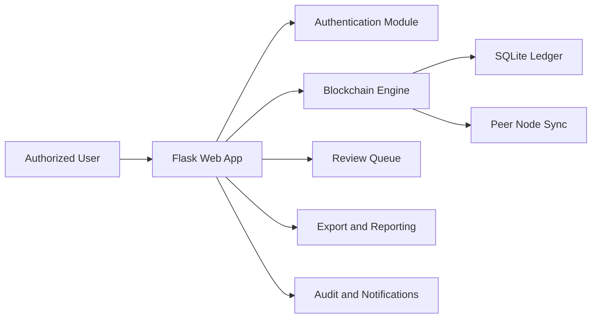

# Project Report

## Title

Secure Decentralized Data Storage for EdTech

## Abstract

HashVera is a blockchain-inspired web application for storing academic records in a tamper-evident decentralized format. The system targets EdTech environments where student documents such as marksheets, certificates, and approval letters require integrity, traceability, and distributed availability. Each uploaded academic record is stored as a linked block using SHA-256 hashing. Authenticated peer-node replication maintains decentralized storage across multiple HashVera instances, while user authentication is protected through PBKDF2-based password hashing. The project demonstrates how blockchain concepts can improve transparency and trust in educational record management.

## Problem Statement

Educational institutions often store student records in centralized databases. Such systems can suffer from data tampering, single-point failures, and limited traceability. There is a need for a secure and auditable mechanism that preserves record integrity while providing decentralized storage for EdTech workflows.

## Objectives

- Design a secure web-based academic record storage system
- Implement blockchain-based tamper detection
- Provide authenticated peer-node replication for decentralized storage
- Implement role-based access control with campus-verified identity
- Support certificate verification with QR code and PDF export
- Provide audit logs, notifications, and admin tooling for institutional governance

## Modules

### 1. Authentication and identity module

- Campus-verified account activation from a preloaded directory
- Login with Campus Email ID and PBKDF2-hashed passwords
- Role-based session management (Student, Faculty, Exam Cell, Administrator)
- Password reset and forced password change workflows

### 2. Blockchain storage module

- Create blocks from academic record data
- Maintain `previous_hash` links forming a tamper-evident chain
- Generate SHA-256 hashes and HMAC node signatures for every block
- Unique certificate IDs for each minted record
- Store chain data in SQLite

### 3. Decentralized peer-node module

- Authenticated peer-to-peer sync across multiple HashVera instances
- API-based chain exchange with HMAC token verification
- Longest valid chain adoption during sync
- Peer connection testing, status tracking, and sync history

### 4. Integrity verification module

- Recalculate hashes and validate chain order
- Detect broken links or modified content
- Public verification portal for external parties
- Certificate preview with blockchain validation seal and QR code

### 5. Role-based workflow module

- Student record requests and correction requests
- Faculty and Exam Cell review queue for approvals
- In-app notification system for account, record, and system events
- Student portfolio and credential wallet views

### 6. Administration and audit module

- User management with role assignment, disable/enable, and password reset
- Full audit logging for all administrative and record actions
- Database backup, import, export, and recovery tools
- Support ticket system for student inquiries
- Bulk record minting via CSV import
- PDF report and CSV ledger export

## System Architecture

## Algorithm

1. Accept academic record input from an authenticated user.
2. Convert the record into canonical JSON text.
3. Fetch the latest block hash from the database.
4. Generate a new nonce and timestamp.
5. Compute the current block hash using SHA-256.
6. Generate an HMAC node signature using the local signing secret.
7. Store the block in the ledger table.
8. Update peer nodes with the latest chain integrity state.
9. Verify the chain whenever requested by recalculating all blocks.

## Security Features

- SHA-256 hashing for chain integrity
- HMAC-based block signing with node-specific keys
- PBKDF2 password hashing with random salts
- CSRF protection on all state-changing requests
- Session-protected dashboard routes
- Role-based access control on all record operations
- Tamper detection using previous-hash linkage
- Audit logging for all sensitive operations

## Advantages

- Detects record tampering quickly through hash chain verification
- Improves transparency and trust with public verification portal
- Provides authenticated decentralized storage via peer-node sync
- Campus-verified identity model prevents unauthorized access
- Role-based approval workflow ensures institutional governance
- Comprehensive audit trail for accountability
- Certificate verification with QR code support for external parties
- Provides a professional, responsive UI for demonstration and usage

## Limitations

- Peer distribution works across multiple HashVera instances but is not a full distributed consensus system
- Documents are stored as metadata records with optional file attachments rather than encrypted binary storage
- No production cloud encryption or digital signatures yet

## Future Scope

- IPFS or cloud object storage integration for large document archival
- Digital signature integration using X.509 or similar PKI standards
- Smart contract integration for automated approval policies
- Two-factor authentication (TOTP) for enhanced account security
- Institution-to-institution federated verification APIs
- Real-time WebSocket-based notifications and sync updates
- Containerized deployment with Docker for multi-node orchestration
- CI/CD pipeline integration for automated testing and deployment

## Conclusion

HashVera demonstrates a practical and comprehensive approach to secure decentralized data storage for EdTech systems. It combines blockchain fundamentals, authenticated peer-node replication, campus-verified identity management, role-based approval workflows, and web-based usability into a single project suitable for academic submission and demonstration.
